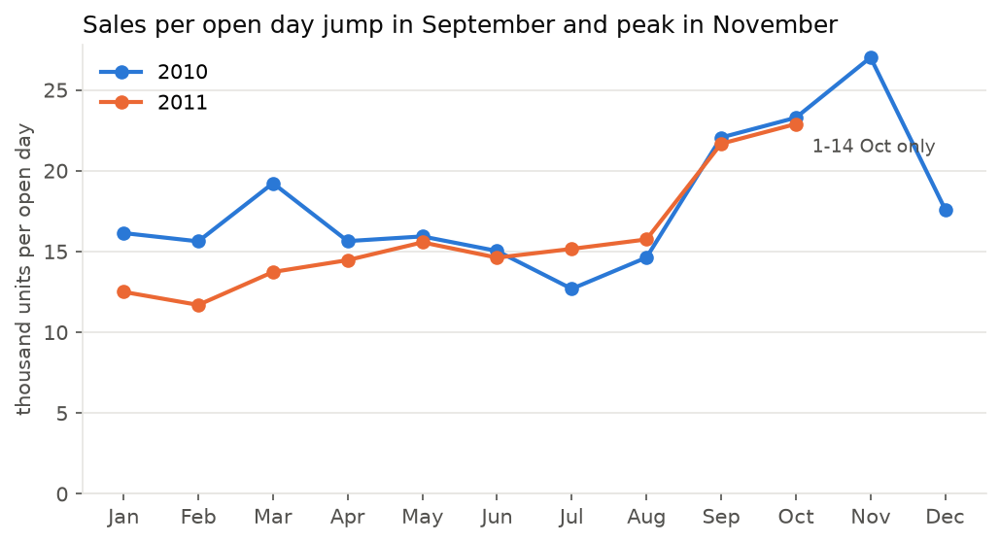
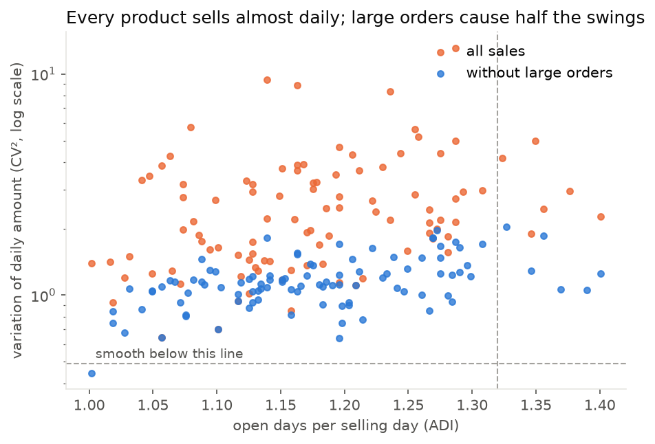
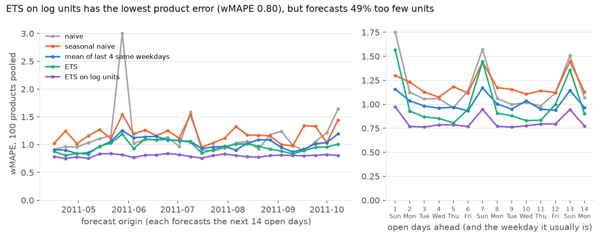
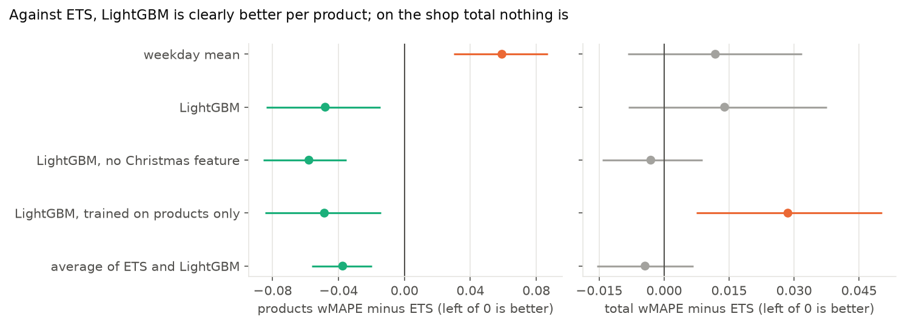
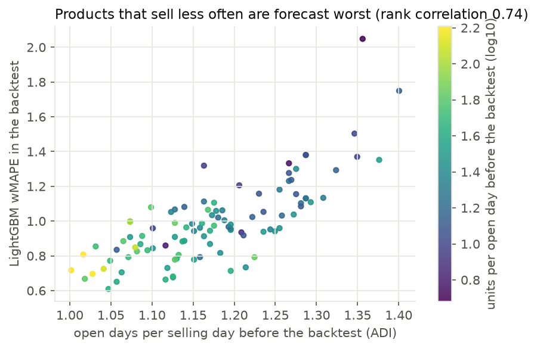
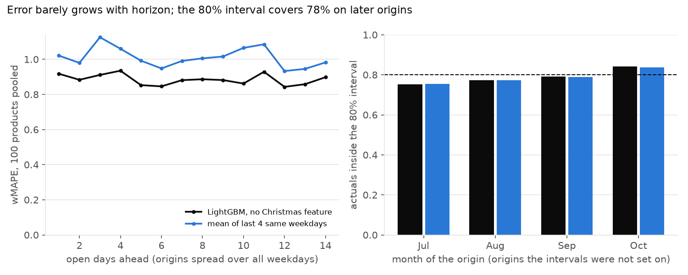

# demand-forecasting

Forecasting how many units of each product a UK online gift retailer will sell per day, two weeks ahead, using two years of real transactions (UCI Online Retail II).

The point is to forecast honestly rather than chase a low error on one lucky split. Every model is compared against naive baselines, scored with rolling-origin backtests over many cut-off dates, and checked by tests that make sure no feature can see the future.

**Status:** in progress (day 9 of 11).

## So far

**Cleaning** ([clean.py](src/demand/clean.py)). 1,044,848 invoice lines go in (after cutting the 22,523 rows the two sheets share) and 997,186 completed product sales come out. Each step is counted in `reports/cleaning.json`:

| Step | Rows removed |
|------|-------------:|
| Lines entered twice | 11,812 |
| Cancellation lines (their units come off the sales they cancel, below) | 19,104 |
| Postage, fees, manual adjustments, vouchers (anything not a 5-digit product code) | 4,784 |
| Stock write-offs and zero prices | 5,928 |
| Sales cancelled in full | 6,028 |
| Bad-debt adjustments | 6 |

Cancellations were the interesting part. Only 36% cancel a sale of exactly the same quantity, so each cancellation instead takes its units off the same customer's earlier sales of that product, newest first. That removes 450,259 cancelled units. 17,480 units couldn't be matched (no customer id, or the sale was before the data starts) and are reported, not guessed. Two orders of 80,995 and 74,215 units, each cancelled within minutes, are gone.

Large orders stay in but are flagged: 7,335 lines (0.7%) carry 2.4 million units, 22% of all demand. That's wholesale lumpiness the models will have to live with. Day 8 compares results with and without them.

**Daily series** ([series.py](src/demand/series.py)). The shop traded on 604 days and was closed on 135: 104 Saturdays plus Christmas and bank holidays. Closed days are left out instead of counted as zero sales. The 100 products that sold on the most days before 16 Apr 2011 (picked before any backtest data, so no look-ahead) make up 20.5% of units and still have no sales on 14% of open days.

**EDA** ([notebook](notebooks/01_eda.ipynb), [eda.py](src/demand/eda.py)). Only data before the 15 Oct 2011 holdout, so the holdout stays unseen.



- **The peak is November, not December.** From 1 September to 14 October, sales per open day run 1.53 times the January to August level in 2010 and 1.55 times in 2011 (same dates both years, because 2011's November is in the holdout). In 2010 they keep rising into November. The customers are mostly wholesalers stocking up for Christmas. December is 35% below November even per open day, so the drop isn't only the shop closing from 24 December.
- **No growth to model.** January to August 2011 is slightly below 2010.
- **Thursday sells 1.23 times an average open day, Sunday 0.57.** Saturday is closed. The seasonal-naive baseline should copy the same weekday last week, not yesterday.
- **Every product sells on most open days, but the amounts swing.** All 100 are "erratic" or "lumpy" by the usual cut-offs. Zeros aren't the problem, so Croston-style methods aren't needed. Without large orders, the median variation (CV²) halves from 2.2 to 1.1, but 99 of 100 are still erratic or lumpy.



What this changes for the next days: the backtest's 26 weekly origins run from April to October, and only the last 8 forecast into September. The holdout is all peak season. So backtest errors will look better than holdout errors, and a model that can't follow the season will look better than it is until the holdout. MAE and wMAPE are the main metrics, because RMSE gets pulled around by a few huge days. 12 tests.

**Baselines** ([baselines.py](src/demand/models/baselines.py), [metrics.py](src/demand/metrics.py), [backtest.py](src/demand/backtest.py)). Three forecasts that need no fitting: the last open day repeated (naive), the last open day with the same weekday (seasonal naive), and the mean of the last 4 same weekdays. Horizons count open days, so a closed Saturday isn't a forecast step. A forecast window is cut where the holdout starts, so no backtest window can see it. Scored at the first backtest origin (16 April 2011, the next 14 open days):

| Baseline | Products MAE | Products wMAPE | Daily total wMAPE |
|---|---:|---:|---:|
| naive | 33.6 | 0.91 | 0.33 |
| seasonal naive | 37.6 | 1.02 | 0.22 |
| mean of last 4 same weekdays | 33.5 | 0.91 | 0.28 |

- **Per product, the error is about as big as the sales** (wMAPE near 1). One product's day is mostly noise, so copying last week's same day is the worst of the three: it copies one erratic number.
- **For the shop's daily total, the weekly pattern wins.** Seasonal naive is clearly best there (0.22). Summed over many products, the noise cancels and the weekday shape is what's left.
- So "beat the baseline" means different baselines: the 4-week weekday mean per product, seasonal naive for the total.
- **One origin is noisy.** Besides Saturdays, the shop was shut on five days in or just before this window (Good Friday, Easter Sunday and Monday, the 29 April royal wedding holiday, 2 May), so a weekday copy often comes from an unusual week. Day 5 scores all 26 origins before any of these numbers are trusted.

30 tests: the split never puts a day at or after the origin into history, never reaches the holdout, skips closed days, and refuses an origin inside the holdout; each baseline refuses to forecast dates inside its history; metrics refuse mismatched or non-finite forecasts and return no wMAPE for a window with no sales.

**Rolling backtest** ([backtest.py](src/demand/backtest.py), [calendar.py](src/demand/calendar.py)). Every forecaster runs at 26 weekly origins from 16 April to 8 October 2011. Each gets a copy of the data before its origin and nothing else, and forecasts the next 14 open days, cut at the holdout. The forecast dates come from a calendar of planned closures (Saturdays, 24 December to 3 January, Easter, bank holidays including the royal wedding), not from the data. It matches every day in the data except one open Saturday in December 2009, so the backtest isn't quietly told about closures in advance.



| Baseline | Products wMAPE | Median per-product wMAPE | Daily total wMAPE | MAE vs seasonal naive |
|---|---:|---:|---:|---:|
| naive | 1.12 | 1.07 | 0.38 | 5% better (products), 1% worse (total) |
| seasonal naive | 1.18 | 1.23 | 0.38 | reference |
| mean of last 4 same weekdays | **1.00** | **1.05** | **0.32** | 15% better (products), 16% better (total) |

- **The 4-week weekday mean is the baseline to beat, at both levels.** The single origin on Day 4 said seasonal naive was best for the total; over 26 origins it isn't. One origin was noise.
- **One order can wreck a forecast.** Naive's spike at the end of May is one product: 4,314 units on Friday 27 May, against a usual 30 to 70 a day. Naive copied it 14 times, and that product alone is 54% of the error at that origin.
- **Horizon here mostly means weekday.** Every origin is a Saturday, so 1 day ahead is always a Sunday, the smallest day with the largest relative error. From 2 to 14 days ahead the error barely grows. Day 9 staggers the origins so error by horizon can be separated from error by weekday.
- The last origin only reaches 6 open days before the holdout, so horizons 7 to 14 rest on 24 or 25 origins, not 26. The report lists the count for each horizon.

18 tests on top: a spy forecaster checks that no forecaster ever sees a day at or after its origin; multiplying every future value by 1,000 leaves every baseline's forecasts unchanged (this test runs for every model added to the registry); a forecaster that edits its input can't affect the next; forecasts for the wrong dates or with missing values, a closure the calendar didn't plan, and dates outside the calendar's years are refused; pooled wMAPE must lie between the per-horizon values. That last test was added after the first chart showed it didn't: the per-horizon product numbers had the shop total mixed in.

**Exponential smoothing and SARIMA** ([statistical.py](src/demand/models/statistical.py)). ETS with a level and an additive weekly season (6 open days, no trend, since Day 3 found no growth) for every product, once on units and once on log(1 + units). SARIMA(1,0,1)(0,1,1)6 for the shop total only, because one fit takes seconds. A fit that fails or returns something absurd falls back to the weekday mean and is counted: none did, out of 2,626 ETS forecasts and 26 SARIMA ones. Same 26 origins:


| Model | Products wMAPE | Median per product | MAE vs weekday mean | Bias (products) | Total wMAPE | Bias (total) |
|---|---:|---:|---:|---:|---:|---:|
| mean of last 4 same weekdays | 1.00 | 1.05 | reference | -1% | 0.32 | -7% |
| ETS | **0.94** | **0.97** | 6% better | +3% | **0.31** | -3% |
| ETS on log units | 0.78 | 0.84 | 22% better | **-48%** | 0.30 | -8% |
| SARIMA | | | | | 0.31 | -5% |

- **The lowest error is a trap.** ETS on log units wins every error score, but it forecasts only half the units that sold. It learns the typical day and ignores large orders. MAE rewards that, and a buyer who restocked from it would run out. That's why every score now comes with bias (units forecast / units sold - 1).
- **ETS is the honest winner, but only just:** 6% less error per product and 4% on the total than the 4-week weekday mean. Day 7's LightGBM has to beat ETS, not the baselines.
- **Holidays nearly hid that.** The first run fitted the models on rows, so each bank holiday shifted the weekly cycle by one day from then on, and a closure inside a forecast window shifted the forecast too. ETS and SARIMA then lost to the weekday mean on the total by 10%. Fitting on a Sunday-to-Friday grid, with closures filled from the week before, turned that into a 4% win.
- **Every model under-forecasts September**: from origins in September, the shop-total forecasts come to 75 to 88% of units sold. It's the step up Day 3 found, and the holdout is all peak season.

17 tests: a clean weekly pattern is learned by all three, a closed weekday in the history or inside the forecast window doesn't shift it, a Saturday forecast is refused, forecasts are never negative, the log model is moved less by one huge order, too-short or constant history and failed or absurd fits fall back and are counted, and the poisoned-future leak test passes for both ETS models.

**LightGBM** ([features.py](src/demand/features.py), [gbm.py](src/demand/models/gbm.py)). One model across all products, retrained at every origin on that origin's history only. Each training row is a past origin, a product and one of the next 14 open days. Its features come only from data before that past origin: the recent level, last week's mean, the same-weekday mean, variability, the share of zero days. Calendar facts about the target date are added: weekday, steps ahead, weeks to Christmas, and whether it follows a closure. Everything is divided by the product's recent level, so a product selling 5 a day and one selling 500 share what they learn. The loss is Tweedie, which aims at the mean, not the median, to stay clear of the log model's bias.

| Model | Products wMAPE | Median per product | Bias | MAE vs weekday mean | Total wMAPE |
|---|---:|---:|---:|---:|---:|
| mean of last 4 same weekdays | 1.00 | 1.05 | -1% | reference | 0.32 |
| ETS | 0.94 | 0.97 | +3% | 6% better | **0.31** |
| LightGBM | **0.89** | **0.96** | -1% | **11% better** | 0.32 |

- **Best per product, with almost no bias, but the win is narrow.** LightGBM beats ETS on only 41 of the 100 products; its pooled lead comes from the big sellers. The median per product barely moves (0.96 against 0.97).
- **No gain on the shop total.** ETS stays best there.
- **What it uses:** the share of zero days (28% of the gain), the level (26%) and weeks to Christmas (21%). That last one is a risk. There's only one earlier autumn to learn from, so it may be learning 2010's calendar, not a rule. The holdout will say. Whether a day follows a closure barely matters (0.4%).
- It still under-forecasts September (92% of units sold), a little less than ETS (89%).

12 tests: features are scaled per product, a product that never sold divides safely, closures and Christmas are known in the calendar features, every training target lies inside the history, training features for a past origin don't change when everything after it is multiplied by 1,000, the model learns a weekly shape for a big and a small seller alike, it's repeatable, and the poisoned-future backtest test passes.

**Model comparison** ([notebook](notebooks/02_model_comparison.ipynb), [compare.py](src/demand/compare.py)). Several models now sit within a few hundredths of each other, so each is compared with ETS origin by origin, with a 95% interval from resampling whole origins.



| Against ETS (wMAPE difference) | Products | Origins better | Shop total |
|---|---:|---:|---:|
| weekday mean | +0.059 (+0.030 to +0.087) | 3 of 26 | +0.012 (-0.008 to +0.032) |
| LightGBM | -0.048 (-0.084 to -0.015) | 17 | +0.014 (-0.008 to +0.038) |
| LightGBM, no weeks-to-Christmas feature | **-0.058 (-0.086 to -0.035)** | **23** | -0.003 (-0.014 to +0.009) |
| LightGBM trained on products only | -0.049 (-0.085 to -0.014) | 18 | +0.029 (+0.007 to +0.050) |
| average of ETS and LightGBM | -0.037 (-0.056 to -0.020) | 20 | -0.004 (-0.015 to +0.007) |

- **Per product, LightGBM is clearly better than ETS**, in every version.
- **On the shop total, nothing is clearly better than anything.** Even ETS against the weekday mean is within noise there. Day 6's "4% better on the total" was real arithmetic, but not a real difference.
- **The weeks-to-Christmas feature was memorising.** It carried 21% of LightGBM's gain on Day 7. Without it, the product score is within noise of the full model and the total gets a bit better (0.321 to 0.304). Learned from one autumn, it was a calendar, not a rule.
- **Training without the shop total hurts the total** and changes nothing for products, so the total stays in training.

**Where forecasts fail.** Product-days with a large order are 2% of days and 23% of units, and carry 20 to 23% of the error: in proportion, not out of it. The bigger split is between products. The ones forecast worst are those that sell less often and less (rank correlation of wMAPE with open days per selling day: 0.74; with level: -0.62). The best products are forecast at about 0.6 wMAPE, the worst at 1.5 to 2.



**Pick for the holdout: LightGBM without the weeks-to-Christmas feature**, for products and the total, scored once alongside ETS and the weekday mean. It's clearly better per product (23 of 26 origins, -3% bias) and ties on the total. The backtest mostly misses the autumn peak, so expect the holdout error to be higher.

11 tests: averaging keeps actuals and drops rows a model lacks, the paired difference by hand with its interval, error on flagged days by hand, a series that never sold, and the new LightGBM variants.

**Error against horizon, and prediction intervals** ([intervals.py](src/demand/intervals.py)). The backtest is rerun with each origin moved one weekday along, so "3 days ahead" is no longer always a Tuesday. Then 80% intervals: for each horizon, the errors at the first 13 origins are scaled by each product's recent level, and their 10th and 90th percentiles become the interval. Whether that covers 80% is measured on the last 13 origins, which the intervals were not set on.



- **Error doesn't grow with horizon.** With origins spread over the week, LightGBM's wMAPE stays between 0.84 and 0.94 from 1 to 14 days ahead, with no trend. The Sunday spikes on Day 5 were the weekday, not the horizon. A product's day is so noisy that knowing yesterday barely helps more than knowing last week.
- **The 80% intervals cover 78% on later origins**: 75% in July, 79% in September, 84% in October (October rests on only 2 origins). Close to the promise, even through the September step.
- **They are wide:** on average 2.3 times a product's usual daily sales from bottom to top. That's the honest size of the uncertainty for one product on one day; summed over a week or a reorder cycle it shrinks.
- **But they fit the average product, not each one.** Per product, coverage runs from 29% to 98%, and 11 of the 100 products are under 60%. One set of quantiles for everything is too narrow for the erratic products and too wide for the steady ones. Quantiles per demand class (how often a product sells, Day 8) are the next step.

7 tests: staggered origins cycle through the six trading weekdays, levels use only days before the origin, intervals cover about what they promise on new data from the same process, under-cover when errors grow, never go below zero, and refuse horizons or origins they have no numbers for.

## Planned approach

1. Clean the transactions: cancellations, returns, non-product rows (postage, fees) and data-entry outliers
2. Build a daily series per product, treating days the shop was closed as missing, not as zero demand
3. Baselines: naive and seasonal-naive (same weekday last week)
4. Models: exponential smoothing / SARIMA, then LightGBM on lag, rolling and calendar features
5. Score with MAE, RMSE and wMAPE (not MAPE, which breaks on zero-sales days), by forecast horizon

## Planned stack

Python 3.12, uv, pandas, statsmodels, LightGBM, matplotlib, pytest, ruff. CI: GitHub Actions with ruff, pytest, pip-audit and Gitleaks.

## Data

[Online Retail II](https://archive.ics.uci.edu/dataset/502/online+retail+ii) by Daqing Chen, UCI Machine Learning Repository, [CC BY 4.0](https://creativecommons.org/licenses/by/4.0/). DOI: 10.24432/C5CG6D. It isn't committed: a script downloads it and checks its hash.

## Quick start

```bash
uv sync
make lint test
make data   # downloads 46 MB, checks its SHA-256, builds the daily series
```

## Architecture

See [docs/ARCHITECTURE.md](docs/ARCHITECTURE.md).

## License

MIT
