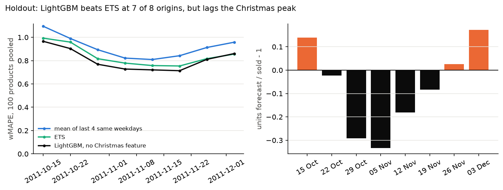
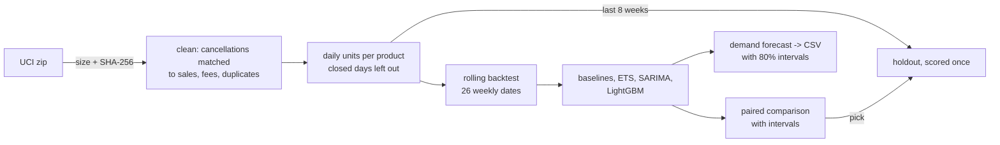

# demand-forecasting

[](https://github.com/AnoushahWasif/demand-forecasting/actions/workflows/ci.yml)
[](LICENSE)

Forecasting how many units of each of 100 products a UK online gift wholesaler sells per day, two weeks ahead, from two years of real transactions (UCI Online Retail II).

The aim was to forecast honestly, not to chase a low error on one lucky split. Every model is compared against simple baselines over 26 rolling forecast dates, with intervals rather than single numbers. Tests make sure no model can see the future. One model was picked on that evidence, then scored once on the last 8 weeks, which nothing had touched.

## Result



On the holdout (8 weekly forecast dates, 15 October to 9 December 2011, the run-up to Christmas):

| Model | Products wMAPE | Bias | Shop total wMAPE | Bias |
|---|---:|---:|---:|---:|
| **LightGBM, one model for all products** | **0.79** | -11% | 0.24 | -2% |
| Exponential smoothing (ETS) | 0.83 | -8% | **0.22** | -6% |
| Mean of the last 4 same weekdays | 0.90 | -11% | 0.24 | -9% |

- **Per product, LightGBM wins.** It beats ETS at 7 of the 8 forecast dates (0.036 lower wMAPE, 95% interval 0.023 to 0.046) and the baseline at all 8. That's what the backtest predicted (23 of 26 dates).
- **On the shop's daily total, nothing clearly beats anything,** also as in the backtest.
- **It lags the peak.** It forecast 29% and 33% too few units from the 29 October and 5 November dates, as sales climbed, then 17% too many after they turned. Two years of data hold one earlier Christmas. The one feature that tried to learn it memorised instead and was dropped.
- **80% intervals held: 81% of product-days fell inside.** But they are wide (2.3 times a product's usual day), and per product the coverage runs from 25% to 96%.

wMAPE is total absolute error divided by total units sold. A product's single day is mostly noise, so 0.79 means the error is about four-fifths of what sold. Summed over a reorder cycle it's much smaller.

## How it works



- **Cleaning.** Cancellations take their units off the same customer's earlier sales of that product, newest first. Only 36% cancel an identical quantity. 450,259 units are removed, and 17,480 that can't be matched are counted, not guessed. Fees, postage and data-entry duplicates go too, each counted in `reports/cleaning.json`.
- **Daily series.** Days the shop was shut are left out rather than counted as zero sales. A calendar of planned closures (Saturdays, Christmas, Easter, bank holidays, the 2011 royal wedding) gives the forecast dates, and it matches the data.
- **Backtest.** At each of 26 weekly dates, every model gets a copy of the data before that date and nothing else. A test multiplies every later value by 1,000 and checks that no forecast changes. It runs for every model in the registry, so new models are covered automatically.
- **Models.** Three baselines; ETS fitted on a Sunday-to-Friday grid; SARIMA for the total; LightGBM across all products, with features scaled by each product's level and a Tweedie loss.
- **Comparison.** Models are compared date by date, with bootstrap intervals that resample whole dates.
- **Intervals.** Errors from earlier dates, scaled by level, give 80% intervals. They are checked on later dates only.

## What didn't work

These shaped the result more than the models did. Each is written up in [docs/RESULTS.md](docs/RESULTS.md).

- **The lowest error was a trap.** ETS on log units had the best MAE and wMAPE of all, and forecast only half the units sold. MAE rewards forecasting the typical day, so on sales with large orders it rewards ordering too little. Since then, every score comes with bias.
- **A holiday bug looked like a finding.** Fitted on rows, ETS and SARIMA lost to the baseline on the total. A missing bank holiday shifted their weekly cycle by a day for good. Fitted on a fixed calendar grid, they tie with the baseline instead.
- **The most important feature was memorising.** "Weeks to Christmas" carried 21% of LightGBM's gain. With one earlier autumn to learn from, it learned that year's calendar. Dropping it cost nothing.
- **One forecast date told the wrong story.** At the first date, seasonal naive looked best for the total. Over 26 dates the mean of the last 4 same weekdays beat it clearly (wMAPE 0.32 against 0.38).
- **"Error by horizon" was error by weekday.** Every backtest date was a Saturday, so "1 day ahead" was always a Sunday. With the dates spread over the week, the error doesn't grow from 1 to 14 days ahead at all.

## Limitations

- One retailer and two years, so one earlier Christmas. Nothing here can learn the peak properly, and the holdout shows the lag.
- The 100 products are the ones that sold on the most days. Products that sell rarely need different methods and aren't covered.
- One set of interval widths for all products. They fit the average product but are too narrow for erratic ones (4 products under 60% coverage on the holdout).
- Large orders (22% of units) are flagged but not predicted. They hurt in proportion to their size, and no model here sees them coming.
- The holdout has 8 forecast dates, so its comparisons are less certain than the backtest's 26.

## Quick start

```bash
uv sync
make lint test                                # 173 tests
uv run demand data                            # downloads 46 MB, checks its SHA-256, builds the series
uv run demand backtest --statistical          # 26 dates, every model (about 45 minutes on a laptop)
uv run python -m demand.backtest --add lightgbm lightgbm_no_christmas lightgbm_products_only
uv run python -m demand.intervals             # staggered dates and 80% intervals
uv run demand forecast --days 14 --out forecast.csv
```

`forecast` refits on all the data and writes one row per day and product, plus the total, with an 80% interval. Cells a spreadsheet would run as formulas are neutralised. `demand holdout` scores the chosen model on the holdout and refuses to run again once `reports/holdout.json` exists.

## Project structure

```
src/demand/
  data.py, clean.py, series.py, build.py   download, check, clean, build the daily series
  calendar.py                              planned closures
  backtest.py, metrics.py, compare.py      rolling backtest, scores with bias, paired comparison
  models/baselines.py, statistical.py, gbm.py
  features.py, intervals.py, cli.py, plots.py
notebooks/  01_eda, 02_model_comparison, 03_holdout
docs/       ARCHITECTURE.md (decisions 1-38, threat model), RESULTS.md (every step's findings)
reports/    JSON results and figures
```

Stack: Python 3.12, uv, pandas, statsmodels, LightGBM, matplotlib, pytest, ruff. CI runs ruff, pytest, the CLI, pip-audit and Gitleaks.

## Data

[Online Retail II](https://archive.ics.uci.edu/dataset/502/online+retail+ii) by Daqing Chen, UCI Machine Learning Repository, [CC BY 4.0](https://creativecommons.org/licenses/by/4.0/), DOI 10.24432/C5CG6D. Not committed: `demand data` downloads it and checks its hash.

## License

MIT
