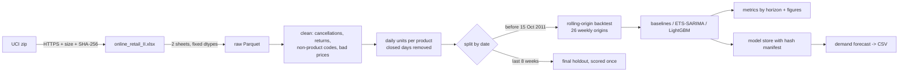

# Architecture

## Context

An offline forecasting project that runs on one laptop: no server, database or cloud. The input is one public file, UCI Online Retail II: 1,067,371 invoice lines from a UK online gift-ware retailer, 1 Dec 2009 to 9 Dec 2011, many of whose customers are wholesalers. The outputs are backtest reports and figures, saved models with a hash manifest, and a CLI that writes a 14-day forecast per product to CSV.

The question it answers: **how many units of each of the retailer's main products will sell on each of the next 14 trading days?** That's what a buyer needs to decide what to reorder and when.

## Forecasting setup

| Item | Choice | Why |
|------|--------|-----|
| Target | Units sold per product per trading day (sum of `Quantity` on completed invoices) | Units, not revenue, drive reordering. Revenue mixes in price changes |
| Products | The 100 products that sold on the most days in the training period, plus the all-products daily total | Most of the ~5,000 stock codes sell on a handful of days. Intermittent demand needs different methods (Croston-style), so it's out of scope and listed under limitations |
| Horizon | 1 to 14 trading days ahead | Two weeks covers a typical reorder cycle. Error is reported per horizon, not just averaged |
| Closed days | A day with no invoices at all is "closed" and dropped from the series, not filled with 0 | A closed shop is not zero demand. Filling zeros would teach the models a fake weekly dip and flatter wMAPE. Checked on day 3: Saturday (one exception in two years) and 24 December to early January |
| Final holdout | The last 8 weeks (from 15 Oct 2011), scored once at the very end | It includes the run-up to Christmas, the hardest and most useful stretch. Only one model setup gets scored on it, so it stays an honest estimate |
| Model selection | Rolling-origin backtest: a new forecast origin every 7 days across the 26 weeks before the holdout, fitting only on data up to each origin | One split would judge models on a single fortnight. 26 origins show how stable the error is and cover spring, summer and autumn |
| Metrics | MAE, RMSE and wMAPE (sum of absolute errors / sum of actuals), per horizon and per product, plus skill against seasonal-naive | MAPE divides by each day's actual and blows up on zero-sales days. wMAPE doesn't. A model counts only if it beats the baselines |
| Baselines | Naive (last value) and seasonal-naive (same weekday, previous week) | Cheap, hard to beat on noisy retail data, and they keep claims honest |

## Components

| Component | Where | What it does |
|-----------|-------|--------------|
| Download | `src/demand/data.py` | Fetches the zip over HTTPS, checks its size and SHA-256 before opening it, reads both xlsx sheets with fixed dtypes, caches them as Parquet in `data/` |
| Cleaning | `src/demand/clean.py` | Removes cancellations together with the sales they cancel, non-product codes (postage, fees, manual adjustments), zero or negative prices and exact duplicates. Each removal step's row count goes to a report |
| Series | `src/demand/series.py` | Builds the daily units panel per product, works out closed days, picks the top-100 products from the training window only |
| Backtest | `src/demand/backtest.py` | Generates forecast origins, gives each model only the data before its origin, collects forecasts by horizon |
| Metrics | `src/demand/metrics.py` | MAE, RMSE, wMAPE and skill vs seasonal-naive. Handles all-zero windows explicitly |
| Models | `src/demand/models/` | Baselines, exponential smoothing / SARIMA (statsmodels), LightGBM on lag, rolling and calendar features |
| Model store | `src/demand/model_store.py` | Saves models with a manifest (SHA-256, data hash, training window, git commit) and refuses to load a file whose hash doesn't match |
| CLI | `src/demand/cli.py` | `demand backtest`, `demand train`, `demand forecast --days 14 --out forecast.csv` |
| Notebooks | `notebooks/` | EDA and model comparison. They import from `src/demand` instead of copying code |

## Data flow

## Decisions

| # | Decision | Why |
|---|----------|-----|
| 1 | Demand means gross sales; returns are measured but not subtracted | A return days later says nothing about what will sell tomorrow. The return rate gets reported separately so it isn't lost |
| 2 | A cancellation takes its units off the same customer's earlier sales of that product, newest first, never below zero. Cancellations with no customer id or no earlier sale only lose their own line (changed on Day 2) | Only 36% of cancellations match a sale of exactly the same quantity; most are partial. Matching on equal quantity would have left about 64% of cancellations removing nothing, their units counted as demand. Two huge orders (80,995 and 74,215 units) were entered and cancelled within minutes |
| 3 | `Customer ID` is used only to match cancellations, then dropped. It never reaches processed data, reports or forecasts | The model doesn't need it, and it's the closest thing to personal data in the set |
| 4 | Product choice, scaling and every feature are computed only from data before each forecast origin, and tests check this by changing future rows and asserting the forecast doesn't move | Look-ahead leakage is the most common way a forecast looks better than it is |
| 5 | Very large single orders stay in the data, are flagged, and get a backtest with and without them | They're real wholesale demand, but one of them can swamp a product's error. Showing both is more honest than quietly capping |
| 6 | LightGBM models are saved in its text format, never pickled. statsmodels results are saved with a SHA-256 manifest that is checked before loading | Loading a pickle runs code, so a swapped file mustn't load silently. Same approach as `customer-churn-prediction` |
| 7 | The forecast CSV escapes text cells starting with `=`, `+`, `-`, `@`, tab or carriage return | Product descriptions come from the data and the file will be opened in Excel (formula injection) |
| 8 | Every run writes the data hash, parameters and git commit next to its results | A number in the README can be traced to the exact run that produced it |
| 9 | The two sheets overlap from 1 to 9 Dec 2010 (the same 1,088 invoices). Each sheet is used only on its side of 1 Dec 2010 (Day 2) | A blanket duplicate drop would also remove repeats inside a sheet, which are a separate question |
| 10 | Lines repeated exactly within a sheet (same invoice, product, quantity, price and minute) are dropped and counted: 11,812 rows, 32,065 units (Day 2) | Almost certainly double entry. It's 0.3% of units, so the choice barely moves the totals either way |
| 11 | Products are codes matching `^\d{5}[A-Za-z]{0,2}$`; everything else is dropped and counted by code (Day 2) | An allow-list can't miss a new fee code the way a deny-list (POST, DOT, M, BANK CHARGES...) can |
| 12 | The 100 products are picked once, on data before the first backtest origin (16 Apr 2011), and the set stays fixed (Day 2) | Picking on data up to the holdout would favour products that were still selling in October: survivorship leakage into every earlier origin |
| 13 | EDA uses only data before the holdout (Day 3) | Whatever the EDA shows shapes the models. If it saw the holdout, the holdout would no longer be an unseen test |
| 14 | Monthly and seasonal comparisons use units per open day, not totals (Day 3) | December has 20 open days, not 26. Totals made it look like demand halved; per open day it fell 35% |
| 15 | MAE and wMAPE lead; RMSE is reported but not used to pick models (Day 3) | Daily amounts are erratic (median CV² 2.2), and RMSE squares the few huge days, so one wholesale order would decide the ranking |
| 16 | No Croston-type methods for intermittent demand (Day 3) | All 100 products sell on 71% or more of open days. The problem is the size of each day's sales, not the zeros |
| 17 | Horizons count open days, and a forecast window stops where the holdout starts (Day 4) | A closed Saturday has nothing to forecast. Cutting at the holdout means the last backtest origins get fewer steps instead of a peek at the holdout |
| 18 | A third baseline: the mean of the last 4 same weekdays (Day 4) | Per product, seasonal naive copies one noisy day and is the weakest baseline. A model has to beat the best simple forecast to count, not the easiest one |
| 19 | Products and the daily total are scored separately (Day 4) | They behave differently: the total is smooth with a strong weekday shape, single products are noise-dominated. Pooling them would let the total's large numbers hide the product error |
| 20 | Forecast dates come from a calendar of planned closures, checked against the data (Day 5) | Taking them from the data would tell every forecaster about closures in hindsight. All 31 non-Saturday closures were planned (Christmas, Easter, bank holidays), so the calendar matches; the backtest refuses an origin where it doesn't |
| 21 | One harness runs every forecaster and hands it only a copy of the history; a poisoned-future test covers every registered model (Day 5) | The leak test lives in one place and new models get it for free. A copy stops a model that edits its input from changing what the next one sees |
| 22 | The median per-product wMAPE is reported next to the pooled one (Day 5) | Pooled numbers are dominated by the best sellers. A model could win them by getting a few big products right |
| 23 | Every score comes with bias, and a model more than 10% off on units can't be picked on MAE or wMAPE alone (Day 6) | MAE is lowest for a forecast of the typical day. On sales with large orders that means forecasting too few units: ETS on log units scored best and forecast half of what sold |
| 24 | ETS with a level and a weekly season of 6 open days, no trend; SARIMA only for the shop total (Day 6) | Day 3 found no growth to model. SARIMA takes seconds per fit, too slow for 2,626 product forecasts on a laptop |
| 25 | A failed or absurd fit falls back to the weekday mean, and the fallbacks are counted and reported (Day 6) | A model that quietly became the baseline would look as good as the baseline with nobody noticing |

## Limitations (known before starting)

- One retailer, two years. Only one full Christmas (2010) comes before the holdout's Christmas run-up, so the model sees the seasonal peak once.
- No prices, promotions, stock-outs or marketing data. A day with no sales might mean the item was out of stock, and that can't be told apart from no demand.
- The top 100 products are the easy, frequently-sold part. The long tail is left out, not forecast badly.
- Wholesale customers make demand lumpy: a few big orders drive much of the variance.

## Threat model (STRIDE)

Small attack surface: one download over the network, files on local disk, a CLI run by its owner.

| STRIDE | Threat | Mitigation |
|--------|--------|------------|
| **Spoofing** | A fake dataset is served instead of UCI's | HTTPS only, fixed URL, SHA-256 checked before the file is opened |
| **Tampering** | A crafted xlsx attacks the parser (XML entity expansion, zip bomb) | Hash checked first. Zip size and uncompressed member size are checked before extraction. `defusedxml` is installed, so openpyxl uses it; read-only mode |
| **Tampering** | A swapped model file runs code when loaded | Text format for LightGBM, SHA-256 manifest checked before loading anything (decision 6) |
| **Tampering** | A product description becomes an Excel formula in the forecast CSV | Cells escaped on write (decision 7), with a test |
| **Repudiation** | A reported number can't be traced to the run that made it | Data hash, parameters and git commit saved with every run (decision 8) |
| **Information disclosure** | Customer ids leak into outputs | Dropped after cancellation matching. A test checks that no output file has a customer column |
| **Denial of service** | A huge or malformed file exhausts memory | Size limits before reading, fixed dtypes, a clear error instead of a crash |
| **Elevation of privilege** | CI token is misused by a dependency | Workflow `permissions: contents: read`, `uv sync --frozen` with a lock file, pip-audit and Gitleaks in CI, Dependabot on |
