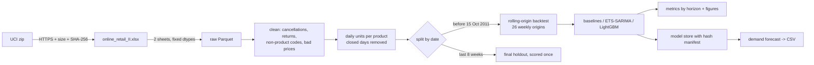

# Architecture

## Context

An offline forecasting project that runs on one laptop: no server, database or cloud. The input is one public file, UCI Online Retail II: 1,067,371 invoice lines from a UK online gift-ware retailer, 1 Dec 2009 to 9 Dec 2011, many of whose customers are wholesalers. The outputs are backtest reports and figures, saved models with a hash manifest, and a CLI that writes a 14-day forecast per product to CSV.

The question it answers: **how many units of each of the retailer's main products will sell on each of the next 14 trading days?** That's what a buyer needs to decide what to reorder and when.

## Forecasting setup

| Item | Choice | Why |
|------|--------|-----|
| Target | Units sold per product per trading day (sum of `Quantity` on completed invoices) | Units, not revenue, drive reordering. Revenue mixes in price changes |
| Products | The 100 products that sold on the most days in the training period, plus the all-products daily total | Most of the ~5,000 stock codes sell on a handful of days. Intermittent demand needs different methods (Croston-style), so it's out of scope and listed under limitations |
| Horizon | 1 to 14 trading days ahead | Two weeks covers a typical reorder cycle. Error is reported per horizon, not just averaged |
| Closed days | A day with no invoices at all is "closed" and dropped from the series, not filled with 0 | A closed shop is not zero demand. Filling zeros would teach the models a fake weekly dip and flatter wMAPE. Which weekday is closed (Saturday, it seems) and the Christmas break get checked on day 3 |
| Final holdout | The last 8 weeks (from 15 Oct 2011), scored once at the very end | It includes the run-up to Christmas, the hardest and most useful stretch. Only one model setup gets scored on it, so it stays an honest estimate |
| Model selection | Rolling-origin backtest: a new forecast origin every 7 days across the 26 weeks before the holdout, fitting only on data up to each origin | One split would judge models on a single fortnight. 26 origins show how stable the error is and cover spring, summer and autumn |
| Metrics | MAE, RMSE and wMAPE (sum of absolute errors / sum of actuals), per horizon and per product, plus skill against seasonal-naive | MAPE divides by each day's actual and blows up on zero-sales days. wMAPE doesn't. A model counts only if it beats the baselines |
| Baselines | Naive (last value) and seasonal-naive (same weekday, previous week) | Cheap, hard to beat on noisy retail data, and they keep claims honest |

## Components

| Component | Where | What it does |
|-----------|-------|--------------|
| Download | `src/demand/data.py` | Fetches the zip over HTTPS, checks its size and SHA-256 before opening it, reads both xlsx sheets with fixed dtypes, caches them as Parquet in `data/` |
| Cleaning | `src/demand/clean.py` | Removes cancellations together with the sales they cancel, non-product codes (postage, fees, manual adjustments), zero or negative prices and exact duplicates. Each removal step's row count goes to a report |
| Series | `src/demand/series.py` | Builds the daily units panel per product, works out closed days, picks the top-100 products from the training window only |
| Backtest | `src/demand/backtest.py` | Generates forecast origins, gives each model only the data before its origin, collects forecasts by horizon |
| Metrics | `src/demand/metrics.py` | MAE, RMSE, wMAPE and skill vs seasonal-naive. Handles all-zero windows explicitly |
| Models | `src/demand/models/` | Baselines, exponential smoothing / SARIMA (statsmodels), LightGBM on lag, rolling and calendar features |
| Model store | `src/demand/model_store.py` | Saves models with a manifest (SHA-256, data hash, training window, git commit) and refuses to load a file whose hash doesn't match |
| CLI | `src/demand/cli.py` | `demand backtest`, `demand train`, `demand forecast --days 14 --out forecast.csv` |
| Notebooks | `notebooks/` | EDA and model comparison. They import from `src/demand` instead of copying code |

## Data flow

## Decisions

| # | Decision | Why |
|---|----------|-----|
| 1 | Demand means gross sales; returns are measured but not subtracted | A return days later says nothing about what will sell tomorrow. The return rate gets reported separately so it isn't lost |
| 2 | A cancellation removes the sale it cancels (same customer, product and quantity) when one can be found; otherwise only the cancellation line is dropped | Some huge orders were entered and cancelled the same day. Keeping the order and dropping only the cancellation would create demand that never happened |
| 3 | `Customer ID` is used only to match cancellations, then dropped. It never reaches processed data, reports or forecasts | The model doesn't need it, and it's the closest thing to personal data in the set |
| 4 | Product choice, scaling and every feature are computed only from data before each forecast origin, and tests check this by changing future rows and asserting the forecast doesn't move | Look-ahead leakage is the most common way a forecast looks better than it is |
| 5 | Very large single orders stay in the data, are flagged, and get a backtest with and without them | They're real wholesale demand, but one of them can swamp a product's error. Showing both is more honest than quietly capping |
| 6 | LightGBM models are saved in its text format, never pickled. statsmodels results are saved with a SHA-256 manifest that is checked before loading | Loading a pickle runs code, so a swapped file mustn't load silently. Same approach as `customer-churn-prediction` |
| 7 | The forecast CSV escapes text cells starting with `=`, `+`, `-`, `@`, tab or carriage return | Product descriptions come from the data and the file will be opened in Excel (formula injection) |
| 8 | Every run writes the data hash, parameters and git commit next to its results | A number in the README can be traced to the exact run that produced it |

## Limitations (known before starting)

- One retailer, two years. Only one full Christmas (2010) comes before the holdout's Christmas run-up, so the model sees the seasonal peak once.
- No prices, promotions, stock-outs or marketing data. A day with no sales might mean the item was out of stock, and that can't be told apart from no demand.
- The top 100 products are the easy, frequently-sold part. The long tail is left out, not forecast badly.
- Wholesale customers make demand lumpy: a few big orders drive much of the variance.

## Threat model (STRIDE)

Small attack surface: one download over the network, files on local disk, a CLI run by its owner.

| STRIDE | Threat | Mitigation |
|--------|--------|------------|
| **Spoofing** | A fake dataset is served instead of UCI's | HTTPS only, fixed URL, SHA-256 checked before the file is opened |
| **Tampering** | A crafted xlsx attacks the parser (XML entity expansion, zip bomb) | Hash checked first. Zip size and uncompressed member size are checked before extraction. `defusedxml` is installed, so openpyxl uses it; read-only mode |
| **Tampering** | A swapped model file runs code when loaded | Text format for LightGBM, SHA-256 manifest checked before loading anything (decision 6) |
| **Tampering** | A product description becomes an Excel formula in the forecast CSV | Cells escaped on write (decision 7), with a test |
| **Repudiation** | A reported number can't be traced to the run that made it | Data hash, parameters and git commit saved with every run (decision 8) |
| **Information disclosure** | Customer ids leak into outputs | Dropped after cancellation matching. A test checks that no output file has a customer column |
| **Denial of service** | A huge or malformed file exhausts memory | Size limits before reading, fixed dtypes, a clear error instead of a crash |
| **Elevation of privilege** | CI token is misused by a dependency | Workflow `permissions: contents: read`, `uv sync --frozen` with a lock file, pip-audit and Gitleaks in CI, Dependabot on |
